<div align="center">
  

  <h1>Antigravity Project Threads</h1>

  <p>
    Protect your attention and keep parallel AI development calm and orderly in <strong>Antigravity 2.0 Desktop</strong>.
  </p>

  <p>
    
    
    
    <a href="./LICENSE"></a>
  </p>

  <p>
    <strong>English</strong> | <a href="./README.zh-CN.md">简体中文</a> | <a href="./README.zh-TW.md">繁體中文</a>
  </p>
</div>

---

## Highlights

| Feature | What You Get |
| --- | --- |
| 🧭 **Calm Coordinator** | Keep your main window focused on scoping and decisions, free of log noise. |
| 🌿 **Isolated Parallelism** | Run code changes in isolated Git Worktrees and research zero-copy without conflicts. |
| 📥 **Pending Decisions** | Completed threads report back automatically; handle choices, merges, and archive in one click. |
| 👀 **Inline Preview** | Inspect progress, follow up, or switch models right beside your main window. |
| 🧠 **Scoped Memory** | Strict per-project boundaries, clean `#N` numbering, and shared memory synced across threads. |
| 🔄 **Rebind & Updates** | Switch Coordinators in one click and update safely across stable or dev channels. |

## Core Workflow

<p align="center">
  <picture>
    <source media="(prefers-color-scheme: dark)" srcset="./assets/workflow-en-dark.svg" />
    
  </picture>
</p>
<p align="center"><sub>You decide, the Coordinator dispatches, background threads run in parallel, and results flow back to the board for one-click action.</sub></p>

## Quick Start

> Zero external dependencies—runs natively on Antigravity 2.0's built-in Node.js ESM runtime (no `npm install`).

```bash
# macOS / Linux (stable main branch)
mkdir -p ~/.gemini/config/plugins && git clone https://github.com/agy-plugins/project-threads.git ~/.gemini/config/plugins/project-threads
```

```powershell
# Windows PowerShell (stable main branch)
New-Item -ItemType Directory -Force "$HOME\.gemini\config\plugins" | Out-Null; git clone https://github.com/agy-plugins/project-threads.git "$HOME\.gemini\config\plugins\project-threads"
```

| 1️⃣ Enable Plugin | 2️⃣ Pin Coordinator | 3️⃣ Open the Board |
| :---: | :---: | :---: |
| Enable **Project Threads** under **Customizations → Plugins**. | Type `/coord` in your main chat to pin it as the always-on Coordinator. | Click **`+`** in the top-right sidebar for live status, preview, and decisions. |

<details>
<summary><strong>MCP Tools & Technical Details</strong></summary>

### MCP Tools (`project-threads_coordinator`, 8 Tools)

| Tool | Purpose |
| --- | --- |
| `init_project_coordinator` | Bind the current session as `[Coordinator]`, attach lifecycle hooks, and initialize `.agents/rules/project-memory.md`. |
| `dispatch_thread` | Spawn an isolated Git Worktree (`createWorktree: true`) or zero-copy read-only (`createWorktree: false`) background thread via `ConversationService`. |
| `list_threads` | Sync and list active or archived threads scoped to the current project with `#N` / `thr-xxx` IDs, `runState`, Git status, and latest summary. |
| `get_thread_detail` | Refresh and inspect full metadata, Git status, and summary for a single thread by `thr-xxx`, project-local `#N`, or conversation UUID. |
| `send_thread_message` | Send a follow-up instruction to an existing Worker Thread in the background without leaving `[Coordinator]`. |
| `archive_thread` | Archive a thread and safely remove its clean, merged (including `cherry-pick` equivalent) Git Worktree and branch. |
| `update_project_memory` | Read, append, or replace `.agents/rules/project-memory.md` and broadcast updates to all active project Worktrees. |
| `manage_decisions` | Register (`add`), list (`list`), clear (`resolve`), or hide (`dismiss`) pinned **Pending Decisions** with 1–3 quick actions. |

### Architecture & Workflow Mechanics

- **Protocol `v14` & Coordinator Rebinding**: Guarded by `PreInvocation` / `PreToolUse` / `Stop` hooks. Rebinding (**`Switch`** / **`Switch to This`**) migrates active threads and pending explicit decisions without replaying stale idle callbacks, while retired sessions receive a retired notice and write guard.
- **Mode-Aware Archiving & Decisions**: Read-only threads can archive autonomously after reporting; Worktree threads remain open until user acceptance and recognize both regular merges and `cherry-pick` commits before removing clean Worktrees under `../.worktrees/<repo>/<thread-slug>`. Explicit decision cards support `send_coordinator`, `archive_thread`, and `dismiss`, deduplicated against automatic Worktree merge/archive hints.
- **Fail-Closed Isolation & Async Detection**: Scopes threads, bindings, decisions, and memory via live `GetConversation` metadata and the Git repository root. Single-thread tools (`get_thread_detail`, `send_thread_message`, `archive_thread`) require project scope (`coordinatorId` / `workspacePath` / `projectId`) unless passing `scope: "*"`; `#N` lookup requires a leading `#`. Active background `run_command` tasks suppress premature completion notices, and atomic `wx` claim locks deduplicate completion pushes.
- **Models, Telemetry & Native Preview**: Two-tier model family + thinking effort selector with mid-thread switching, unified **`Extra High`** normalization, per-mode defaults, first-class **`inherit` (Follow Coordinator)** resolution, and zero-extra-RPC token/compaction telemetry (cached offline transcript fallback). The Swarm-styled board uses `--pt-*` scoped tokens, real Antigravity project names via `ReadProject`, 1:1 inline **`Preview`** drawers, **`Open ↗`** pop-out, and automatic `English / 简体中文 / 繁體中文` locale sync.
- **Safe Dual-Channel Updater**: Switch between **`stable`** (`origin/main` / `vX.Y.Z`) and **`dev`** (`origin/dev` pre-releases) from Sidecar Settings. One-click Git updates enforce clean-tree checks and `--ff-only` fast-forwards (never `git reset --hard`), non-Git installs link to GitHub Releases, and version-drift guards warn when the running sidecar lags behind updated files.

</details>

<details>
<summary><strong>Dev Channel, Project Structure & Testing</strong></summary>

### Development & Pre-Release Channel (`dev`)

You can switch between **`stable`** and **`dev`** inside Sidecar **Settings → Version & Updates** (for clean Git installs), or use Git directly:

```bash
# Clone dev branch directly
git clone -b dev https://github.com/agy-plugins/project-threads.git ~/.gemini/config/plugins/project-threads

# Or switch an existing install to dev
cd ~/.gemini/config/plugins/project-threads && git fetch origin && git checkout dev && git pull
```

### Project Structure

```text
project-threads/
├── plugin.json                 # Antigravity 2.0 plugin manifest
├── mcp_config.json             # Coordinator MCP server registration
├── hooks.json                  # PreInvocation / PreToolUse / Stop lifecycle hooks
├── assets/logo.svg             # Vector plugin & repository logo
├── rules/AGENTS.md             # Persistent Coordinator & Worktree isolation rules
├── skills/coord/SKILL.md       # /coord skill workflow instructions
├── mcp/server.mjs              # Stdio MCP server (8 orchestration tools)
├── scripts/hook-handler.mjs    # Completion extraction, atomic dedup, retired guard & v14 sync
├── lib/
│   ├── ls-client.mjs           # Local ConversationService / LanguageServerService client
│   ├── model-format.mjs        # Two-tier model catalog, effort formatting & inherit resolution
│   ├── store.mjs               # Scoped registry, #N sequences, decisions, rebinding & Worktree sync
│   ├── transcript.mjs          # Transcript parser, async task detector & usage telemetry
│   └── updater.mjs             # Dual-channel update checker & safe fast-forward local updater
├── sidecars/threads/
│   ├── sidecar.json            # Auxiliary Pane Sidecar manifest
│   ├── package.json
│   ├── main.mjs                # Local API server, version-drift guard & no-cache asset router
│   ├── index.html              # Swarm-styled board, Pending Decisions, settings & preview drawer
│   ├── theme.css               # --pt-* scoped design tokens (light & dark themes)
│   └── app.js                  # Live polling, decisions, rebinding, preview, picker, updater & i18n
└── tests/*.test.mjs            # Zero-dependency Node.js test suite
```

### Testing

```bash
node --test tests/*.test.mjs
```

</details>

---

Community: [LINUX DO](https://linux.do) | License: [MIT License](./LICENSE) © 2026 [ShawnJim](https://github.com/ShawnJim)
